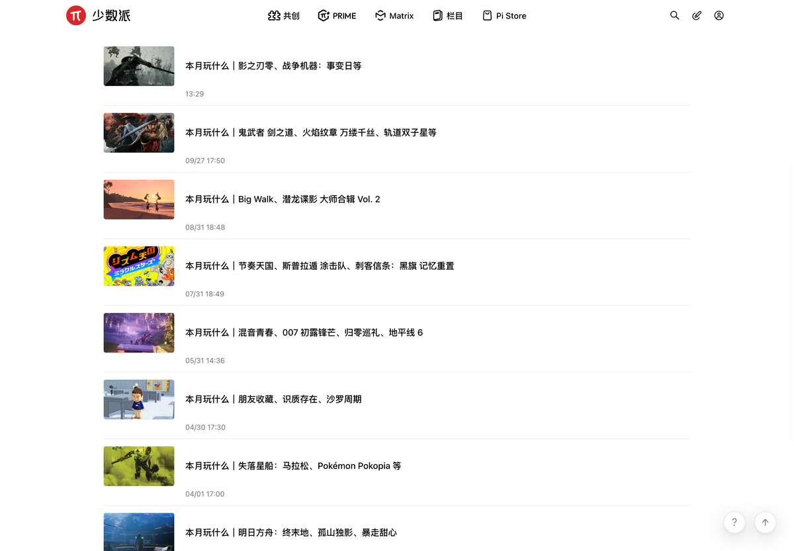

# 少数派 · 阅读增强

一个 Tampermonkey 用户脚本，把 [sspai.com](https://sspai.com) 改成一个**只用来读东西**的地方。

- **首页 / Matrix / 作者主页**：列表拉宽压紧，一屏从 2 篇变成 10 篇，滚到底自动加载
- **作者主页**：进去直接就是文章列表（站点原本把你甩到「动态」），并按首页的样式重排
- **文章页**：读完就结束 —— 打赏卡、文末广告、讨论区、关联阅读、正文里插的「发表首评」全清掉
- **全站**：右下角只留返回顶部，客服问号按钮砍掉

正文本身一个字没动：680px 宽 / 17px / 1.8 行高，站点这套参数已经很标准。


## 装法

1. 装 [Tampermonkey](https://www.tampermonkey.net/)（Chrome / Edge / Firefox 应用商店都有；Safari 用 [Userscripts](https://apps.apple.com/app/userscripts/id1463298887)）。
2. 点这个链接直接安装：
   **[sspai-tidy.user.js](https://raw.githubusercontent.com/hulatu/sspai-tidy/main/sspai-tidy.user.js)**
   Tampermonkey 会弹出安装页，点「安装」。
3. 打开 https://sspai.com/ ，生效。

> 装不上就手动来：Tampermonkey 面板 → 添加新脚本 → 把 `.user.js` 的全部内容粘进去替换模板 → `Cmd/Ctrl + S` 保存。

## 改了什么

| | 首页 | Matrix | 作者主页 |
|---|---|---|---|
| 列表宽度 | 588 → **1064px** | 704 → **1064px** | 588 → **1064px** |
| 单条高度 | 189 → **99px** | 155 → **93px** | 174 → **121px** |
| 一屏（1000px 高）能看到 | 2 → **10 篇** | 5 → **8 篇** | 5 → **8 篇** |

### 列表页

- **首页**：去掉顶部 588×588 的巨型轮播、左侧「推荐 / 全部内容 / 话题讨论 / 热门内容」导航、右侧「派友在看」、列表里 1882px 高的「PRIME 会员社区精选」整块、14 条「一派投票 / 讨论」推广卡、2 条「栏目推荐」系列卡。
- **Matrix**：去掉右侧 324px 的「话题征集 / 值得关注 / 专栏推荐」整列。
- **缩略图挪到标题左侧**。原来图贴在行尾，列表拉宽后标题与图之间会空出 600px 空白；左图右文之后空白落在行尾，视觉上看不出来。
- **「重点文章」大卡压平成普通行**。首页那 13 条 `.article__card--important` 原本是 588×588 大图 + 深色面板 + 摘要，单条高 795px，夹在列表里会突然断开节奏。现在改成和普通行一样的左图右文（摘要保留，压成一行灰色小字），高度统一到 99px。
- **重点卡的文字配色也对齐普通行**。这类卡原本是「深色面板」配色，作者名 / 时间 / 摘要都用了主文字色（浅色主题下就是纯黑），压成透明行之后比旁边那行明显更深。现在次要信息统一走站点自己的次要灰（`--B6-t`），浅色深色两套主题都自动跟随。
- **Matrix 滚到底自动点「加载更多」**。首页本来就有无限滚动，Matrix 没有，现在两边都能一直往下刷（实测 20 → 100 篇）。
- **作者主页默认显示文章列表**。站点进 `/u/:id` 会把你甩到「动态」，而文章列表 `/u/:id/posts` 藏在「动态」标签的下拉里，页面上根本没有入口。
- **作者主页按首页列表重排**。原本每篇套了「头像 + 创作了一篇文章 + 一张小卡片」三层，一行占 174px，卡片宽度还写死 430px。现在去掉重复的头像列、脱掉卡片底、把标题日期按首页的节奏排，一行 121px。



### 文章详情页：读完就结束

一篇 11000px 的文章，原文总高 **13466px**，其中约 2400px（18%）不是正文。清完是 **11097px**。

| 清掉的块 | 高度 | 是什么 |
|---|---|---|
| `.article__charge__card` | 222px | 「N 位派友已充电」打赏卡 |
| `.advertisement__box` | **398px** | 文末广告位 |
| `.post__comments` | 237px | 讨论区 |
| `.related__read__wrapper` | 864px | 「关联阅读」 |
| `.comment__footer__wrapper` ×7 | 392px | 正文每个章节末尾的「发表首评 + 表情」互动条 |

保留：正文、文章标签与责编信息、底部固定的「说点什么… / 分享」栏。


### 全站：右下角只留「返回顶部」

右下角原本是两个 40×40 圆钮：联系客服（问号）+ 返回顶部。客服按钮对阅读没有用处，砍掉。工具条是靠右对齐的 flex，去掉左边那个之后整体宽度从 96px 收到 40px，返回顶部的位置一点没动，也不会留下空隙。

**保留**：顶部导航、搜索、登录、写作入口、Matrix 的「社区广场 / 专栏 / 一派」和「精选 / 热门 / 随便看看」。

深色主题下同样生效，颜色全部走站点自己的 CSS 变量：


## 想微调

脚本开头有一个 `CFG`，改完保存即生效：

```js
const CFG = {
  hideHero:      true,   // 顶部大 banner 区（派早报 / 投稿须知 / 广告位）
  hideLeftNav:   true,   // 首页左侧分类导航
  hideRightSide: true,   // 右侧栏
  hidePrime:     true,   // PRIME 会员社区精选
  hidePromo:     true,   // 一派投票 / 讨论推广卡
  hideCustomerService: true, // 右下角「联系客服」问号按钮（保留旁边的返回顶部）
  autoLoad:      true,   // 滚到底自动加载
  thumb:         128,    // 缩略图宽度 px，0 = 不显示缩略图
  thumbSide:     'left', // 'left' 图在左；'right' 保持站点原样
  compact:       true,   // false = 行高恢复宽松
  userDefaultPosts: true, // 进作者主页默认显示「文章」列表
  userWide:      true,   // 作者主页也拉宽、按首页样式重排

  // 文章详情页：读完就结束
  hideArticleCharge:   true, // 「N 位派友已充电」打赏卡
  hideArticleAd:       true, // 文末广告位
  hideArticleComments: true, // 讨论区
  hideArticleRelated:  true, // 「关联阅读」
  hideInlineComment:   true  // 正文各章节末尾的「发表首评」互动条
};
```

几个常见的改法：

- 想更极端地只看标题：`thumb: 0`，变成纯文字列表，一屏能到 14 篇
- **想留评论区**（少数派的评论质量通常不错）：`hideArticleComments: false`
- 想保留作者页的「动态」默认：`userDefaultPosts: false`
- 只想改宽度、不想动排版：`userWide: false`

## 注意

- 少数派改版后类名可能会变，脚本会失效（页面恢复原样，不会坏）。到时候把新的类名替换进脚本里的选择器即可。
- 改宽度和行高的规则只在窗口 ≥1000px 时生效，窄窗口下用站点自己的布局，不会打架。
- 作者页的跳转只在**进入主页那一刻**发生：进去之后再手动点「动态 / 收藏」，不会被抢回来。
- 文章页那两个 `.article__subsection__wrapper` 只能清里面的内容块，**不能整个藏掉** —— 底部那条「说点什么…」固定栏的占位元素挂在里面，整块 `display:none` 会让那条栏塌成 0×0。脚本里已经按这个约束写了。
- 脚本只改样式、点一下「加载更多」、切一下作者页标签；不碰登录态、不读你的数据、不发任何请求。

## 兼容性

在 Chrome（Helium）+ Tampermonkey 下开发，1440px 窗口实测。首页 / Matrix / 作者主页 / 文章页四条路径都验证过，含浅色与深色主题。

## License

[MIT](LICENSE)
