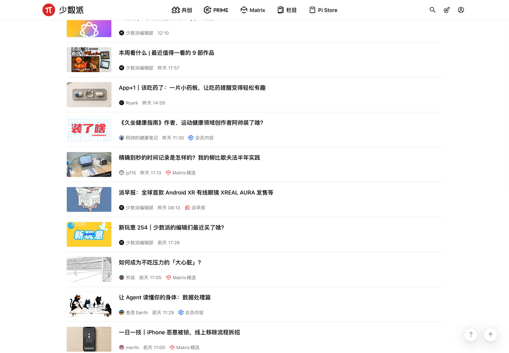
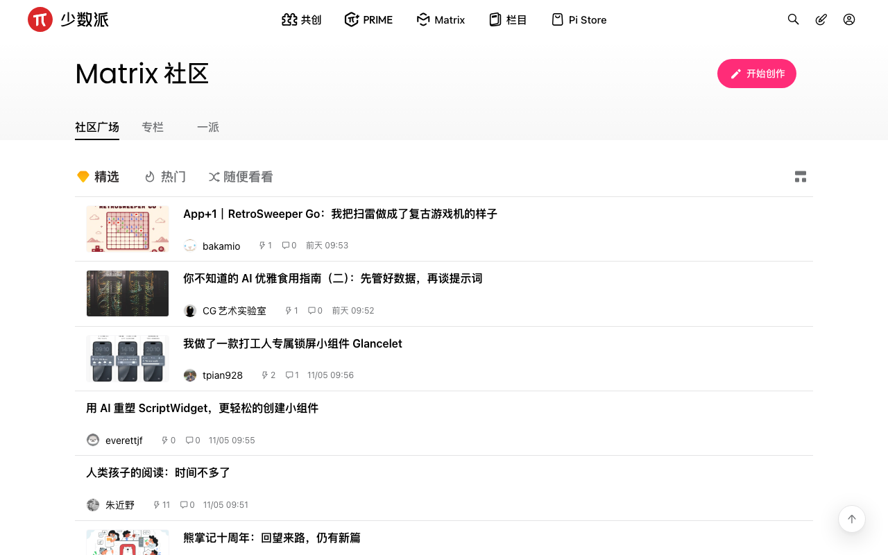
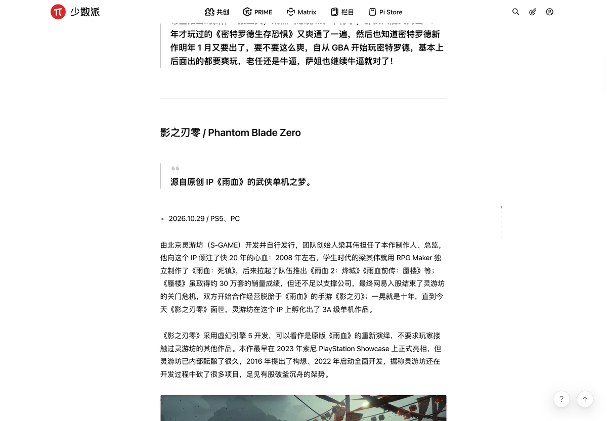
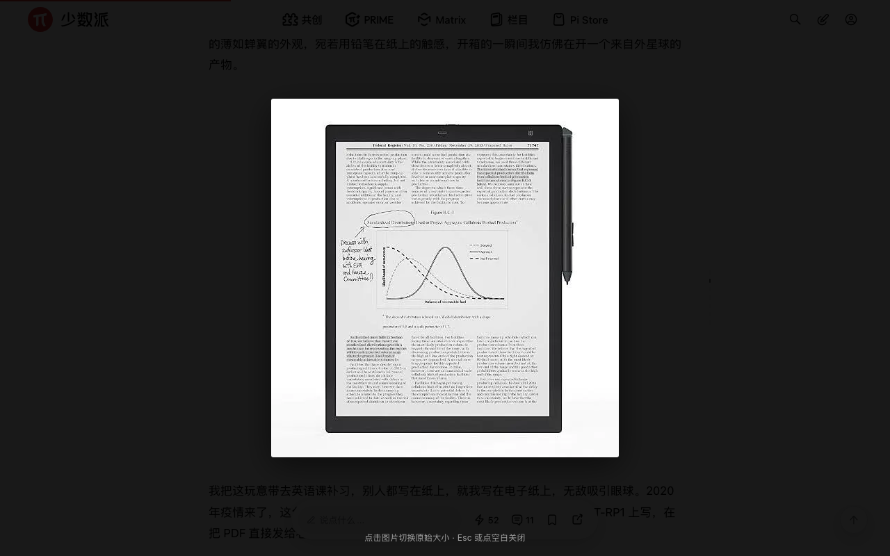
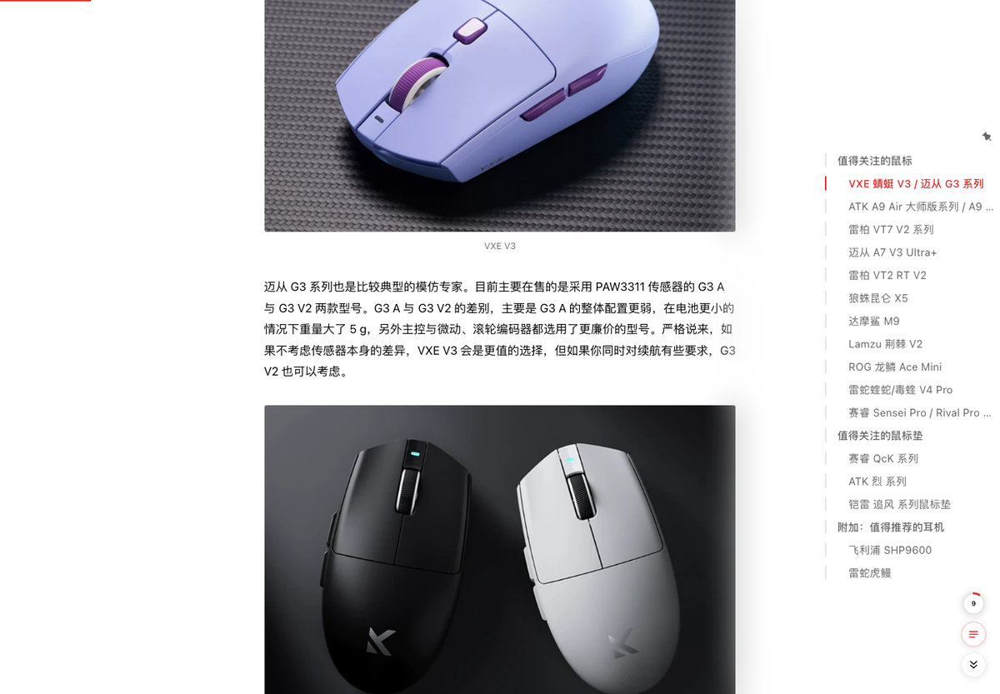
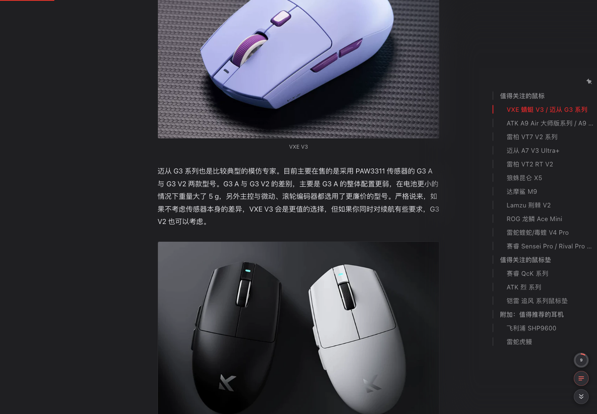
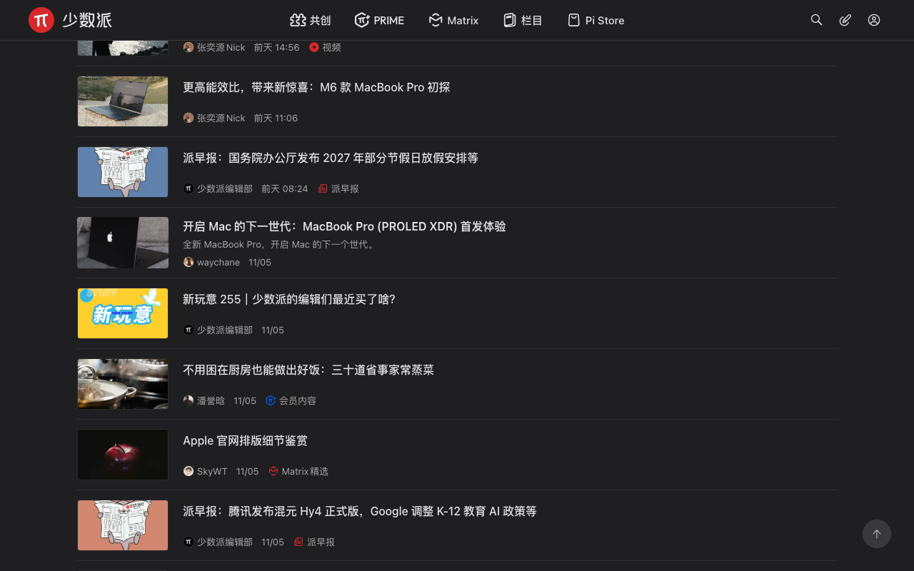

<div align="center">

# 📰 少数派 · 阅读增强

**一个 Tampermonkey 用户脚本，把 [sspai.com](https://sspai.com) 改成一个只用来读东西的地方。**

[](sspai-tidy.user.js)
[](https://sspai.com)
[](https://www.tampermonkey.net/)
[](LICENSE)

**[⬇️ 安装](https://raw.githubusercontent.com/hulatu/sspai-tidy/main/sspai-tidy.user.js)** ・
**[🎛 想改点什么](#-想微调)** ・
**[⚠️ 失效了怎么办](#-注意)**

</div>



## 📑 目录

| 想了解 | 看这里 |
| --- | --- |
| 它到底动了什么 | [🎯 一句话](#-一句话) ・ [📊 数字对比](#-数字对比) |
| 文章页有什么变化 | [📖 文章页：读完就结束](#-文章页读完就结束) |
| 1.3 / 1.4 新增了什么 | [✨ 新增的六件事](#-新增的六件事) |
| 怎么装 | [🚀 装法](#-装法) |
| 想自己调 | [🎛 想微调](#-想微调) |
| 坏了 / 不生效 | [⚠️ 注意](#-注意) |

## 🎯 一句话

少数派的列表页把三分之二的屏幕给了轮播、侧栏和推广卡，文章页在正文之后又堆了近 2000px 的广告、打赏、评论和「关联阅读」。

这个脚本把它们都拿掉，**一屏从 4 篇变成 9 篇，文章页读完正文就结束**；然后补上几个原站没有、但读长文很需要的小东西：进度条、点图放大、代码块复制、已读标记，以及右下角的控制条（进度环 / 目录跳转 / 到底部）和「下滑收起导航」。

## 📊 数字对比

在 1440×900 的窗口下实测（单条 = 一篇的高度）：

| | 首页 | Matrix | 作者主页 |
| --- | --- | --- | --- |
| 列表宽度 | 520 → **1064px** | 741 → **1064px** | 588 → **1064px** |
| 单条高度 | 189 → **99px** | 136 → **92px** | 178 → **121px** |
| 一屏（900px 高）能看到 | 4 → **9 篇** | 6 → **9 篇** | 5 → **7 篇** |



## 📖 文章页：读完就结束

一篇 11000px 的长文，原文总高 **13466px**，其中约 2400px（18%）不是正文。清完是 **11097px**。

| 清掉的块 | 高度 | 是什么 |
| --- | --- | --- |
| `.article__charge__card` | 222px | 「N 位派友已充电」打赏卡 |
| `.advertisement__box` | **398px** | 文末广告位 |
| `.post__comments` | 237px | 讨论区（底部固定栏的评论按钮还能打开弹窗，不算丢了入口） |
| `.related__read__wrapper` | 864px | 「关联阅读」 |
| `.comment__footer__wrapper` ×7 | 392px | 正文每个章节末尾的「发表首评 + 表情」互动条 |

**保留**：正文、文章标签与责编信息、目录、底部固定的「说点什么… / 分享」栏。



## ✨ 新增的六件事

> 1.2 只有「减法」。1.3 补了四个「加法」，1.4 又补了两个 —— 都是原站没有、但读长文会用到的。

### 📊 阅读进度条

文章页顶部一条 2px 的红线，跟着滚动走。首页、Matrix、作者页不显示。
滚到底时宽度到 100%，`requestAnimationFrame` 节流，不占主线程。

### 🖼 点图放大

原站的正文图**点不开**（页面上没有任何图片查看器）。现在点一下就是全屏黑底 + 原图：

- 用的是 `data-original` 里的**原始尺寸**，不是正文那张 1120px 的压缩版
- 再点图片在「适应屏幕 / 原始大小」之间切换
- `Esc` 或点空白处关闭，打开时会锁住页面滚动



### 📋 代码块复制

正文里的 `<pre>` 右上角会出现一个「复制」按钮，悬停才显示，点一下变「已复制」。
复制的是纯文本（不含按钮自己那两个字），优先走 `navigator.clipboard`，不行就退回 `execCommand`。

### ✅ 已读标记

读过的文章，在首页 / Matrix / 作者页的列表里会**压暗到 48%**，鼠标悬停恢复原亮度。
记录只写在你自己浏览器的 `localStorage`（`sspai-tidy:read`），最多存 400 条，不上传任何地方。

### 🧭 右下角控制条

站点右下角原本是两个 40×40 圆钮：联系客服（问号）+ 返回顶部。现在整条换成自己的控制条（`.app_toolbar` 直接隐藏，客服和返回顶部都由它接管）：

| 按钮 | 做什么 |
| --- | --- |
| 进度环 `37` | 显示当前读到百分之多少，点一下回顶部 |
| ☰ 目录 | 只在文章页出现，点一下打开少数派自己的目录 |
| ⌄ 到底部 | 滚到文末；图片懒加载会把页面撑长，停稳后会补一次 |



深色下同一处：



几处刻意的做法：

- **目录不自己画，直接开站点原生的那套**。少数派本来就有目录：≥1280px 是正文右侧那条虚线轨（悬停展开、点图钉钉住），<1280px 是底部弹出的「文章目录」弹层。控制条那个 ☰ 只是把站点自己的目录打开 —— 宽屏等于替你点了图钉，窄屏等于给它弹层加上那两个 class。列表、当前节高亮、点击跳转全是站点的，一个像素都不用抄。
- **钉住之后要自己补 `.visible`**：站点的逻辑是「滚下去才有目录」，回到顶部就把 `.visible` 摘了。钉住期间被摘掉会立刻按回去（挂在 overlay 上的 MutationObserver 干这个），否则目录会莫名其妙消失。
- **开合状态读 DOM，不另存一份**。图钉是 Vue 管的，重渲染会按它自己的状态重写 class，我们另存一个布尔量迟早会对不上。所以每次动手前先确认节点还挂在文档上（`isConnected`），再直接读 `pinned` / `is-dialog-open`。
- **控制条要躲开底部那条「说点什么…」**：它是 fixed、56px 高，控制条在文章页抬到 84px；站点自己下滑收起它时会加 `.translate`，控制条跟着落回 24px。
- **深色下高亮换成亮一档的红**：站点自己的 `--brand` 在深色里仍是 `#da282a`，压在 `#232326` 上只有 3.4:1。

### 🫥 下滑收起导航

往下读的时候，顶部 56px 的导航条会滑出去；往上滑一点立刻回来，回到顶部附近也一定露出来。

只做了顶部导航，没碰底部那条「说点什么…」—— 站点自己就会在向下滚动时把它收走（加 `.translate`），两边各管一半会出现「一个收一个没收」的错位。

实现上有两个坑：

- **用 `top: -80px` 位移，不用 `transform`**。导航条里挂着 fixed 的移动端菜单，父元素一旦有 transform 就会成为它的包含块，菜单会跟着跑到导航条的位置上去。
- **程序化跳转后的 1.5 秒内不收起导航**。否则点「跳到第 3 节」时，落点算的是「导航还在」的 72px，滚完导航却收了，标题上方会空出一条。

**保留**：顶部导航（不滚动时）、搜索、登录、写作入口、Matrix 的「社区广场 / 专栏 / 一派」和「精选 / 热门 / 随便看看」。

## 🚀 装法

1. 装 [Tampermonkey](https://www.tampermonkey.net/)（Chrome / Edge / Firefox 商店都有；Safari 用 [Userscripts](https://apps.apple.com/app/userscripts/id1463298887)）。
2. 点 **[sspai-tidy.user.js](https://raw.githubusercontent.com/hulatu/sspai-tidy/main/sspai-tidy.user.js)** —— 会弹出安装页，点「安装」。
3. 打开 <https://sspai.com/> ，生效。

> 脚本头里写了 `@updateURL` / `@downloadURL`，以后我推新版本，Tampermonkey 会自己提示更新，不用手动重装。

装不上就手动来：Tampermonkey 面板 → 添加新脚本 → 把 `.user.js` 全文粘进去替换模板 → `Cmd/Ctrl + S`。

## 🎛 想微调

脚本开头有一个 `CFG`，改完保存即生效：

```js
const CFG = {
  // ---- 列表页：减法 ----
  hideHero:      true,   // 顶部大 banner 区（派早报 / 投稿须知 / 广告位）
  hideLeftNav:   true,   // 首页左侧「推荐 / 全部内容 / 话题讨论 / 热门内容」
  hideRightSide: true,   // 首页「派友在看」、Matrix「值得关注 / 专栏推荐」
  hidePrime:     true,   // 列表里的 PRIME 会员社区精选
  hidePromo:     true,   // 列表里的「一派投票 / 讨论」推广卡
  hideCustomerService: true, // 右下角「联系客服」问号按钮（保留旁边的返回顶部）
  autoLoad:      true,   // 滚到底自动点「加载更多」（Matrix）
  thumb:         128,    // 列表缩略图宽度 px，0 = 不显示缩略图
  thumbSide:     'left', // 'left' 图在标题左边；'right' 保持站点原样
  compact:       true,   // false = 行高恢复宽松
  userDefaultPosts: true, // 进作者主页默认显示「文章」列表
  userWide:      true,   // 作者主页也拉宽、按首页样式重排

  // ---- 文章页：减法 ----
  hideArticleCharge:   true, // 「N 位派友已充电」打赏卡
  hideArticleAd:       true, // 文末广告位
  hideArticleComments: true, // 讨论区
  hideArticleRelated:  true, // 「关联阅读」
  hideInlineComment:   true, // 正文各章节末尾的「发表首评」互动条

  // ---- 文章页：加法（1.3 新增）----
  progressBar:   true,   // 顶部阅读进度条
  imageViewer:   true,   // 点图放大（用原图）
  codeCopy:      true,   // 代码块右上角「复制」
  markRead:      true,   // 列表里把读过的文章压暗

  // ---- 控制条 + 沉浸阅读（1.4 新增）----
  pageDock:      true,   // 右下角控制条（进度环 / 目录 / 到底部）
  dockToc:       true,   // 控制条里的「目录」，只在文章页出现；点一下打开少数派原生目录
  immersive:     true    // 文章页下滑收起顶部导航
};
```

几个常见的改法：

- **只想清广告，不想动排版**：`compact: false` + `userWide: false`
- **想更极端地只看标题**：`thumb: 0`，变成纯文字列表（单条 99 → 92px），没有图更安静
- **想留评论区**（少数派的评论质量通常不错）：`hideArticleComments: false`
- **不喜欢被压暗**：`markRead: false`（已经记下的条目不会被清掉）
- **只想要阅读进度条**：把上面所有 `hide*` 都改成 `false`，只留 `progressBar: true`
- 想保留作者页的「动态」默认：`userDefaultPosts: false`
- 不想要右下角那条控制条：`pageDock: false`（站点原来的客服 + 返回顶部会回来，`hideCustomerService` 仍然只砍客服）
- 喜欢收起导航、但想留自己的控制条：只关 `immersive`

## 🚧 注意

- **少数派改版后类名可能会变**，脚本会失效（页面恢复原样，不会坏）。到时候把新类名替换进选择器即可 —— 改版最容易先坏的是 `.article__card` / `.post-item` / `.article__main__content` 这三个。
- 改宽度和行高的规则**只在窗口 ≥1000px 时生效**，窄窗口下用站点自己的布局，不会打架。
- 作者页的跳转只在**进入主页那一刻**发生：进去之后再手动点「动态 / 收藏」，不会被抢回来。
- 文章页那两个 `.article__subsection__wrapper` 只能清里面的内容块，**不能整个藏掉** —— 底部那条「说点什么…」固定栏的占位元素挂在里面，整块 `display:none` 会让那条栏塌成 0×0。脚本里已经按这个约束写了。
- 站点把整列包在 `.feed__wrapper` 里，并写死 `max-width: 960px`；只改 `.feed` 会被它卡住（实测只能到 960 / 卡片 904），所以两个都要放开。
- 控制条躲底部栏用的是 `body:has(.article__bar__wrapper)`，需要 Chrome 105+ / Safari 15.4+。老浏览器上它只会停在 24px（压住底部栏右下角那块空白），点击不受影响。
- 目录读的是正文里的 `h2 / h3`。文章没有小节标题时，目录按钮不出现。
- 脚本只改样式、点几下按钮、写一条本地的已读记录、滚一下页面；**不碰登录态、不读你的数据、不发任何请求**。

## 🧪 兼容性

在 Chrome（Helium 157）+ Tampermonkey 下开发，1440×900 窗口实测；首页 / Matrix / 作者主页 / 文章页四条路径都验证过，含浅色与深色主题。

用到的都是现代 CSS（`:has()`、`aspect-ratio`、CSS 变量），Chrome 105+ / Safari 15.4+ / Firefox 121+ 都没问题。

深色主题下同样生效，颜色全部走站点自己的 CSS 变量：



## 📄 许可

[MIT](LICENSE) —— 随便改、随便用，出问题别找我。
