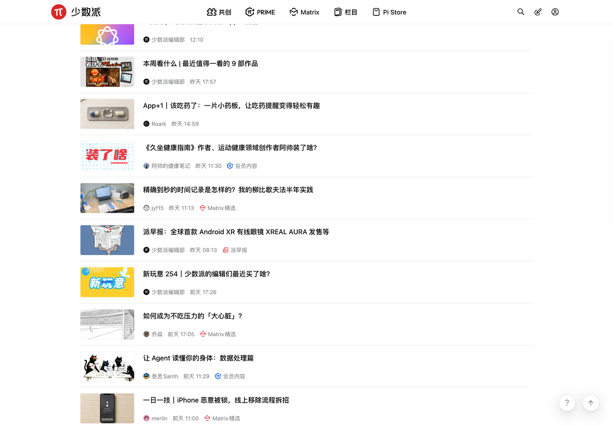
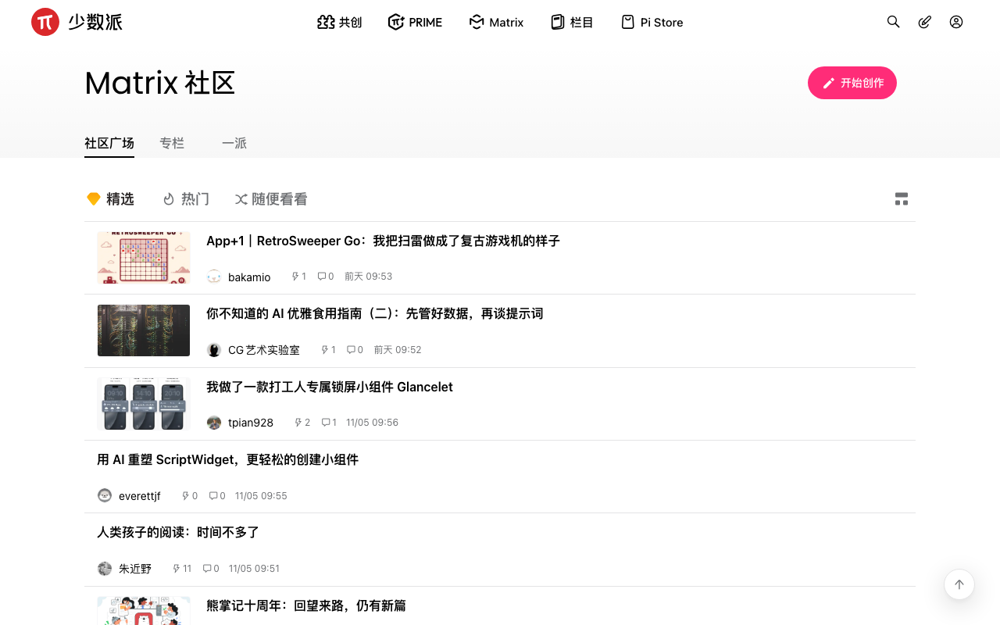
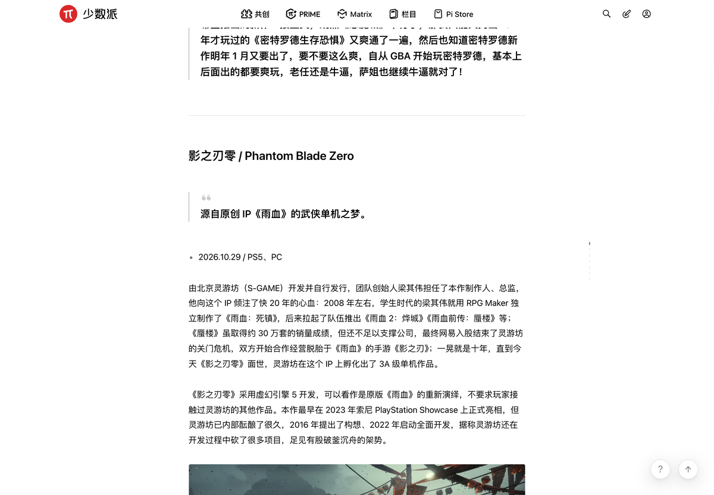
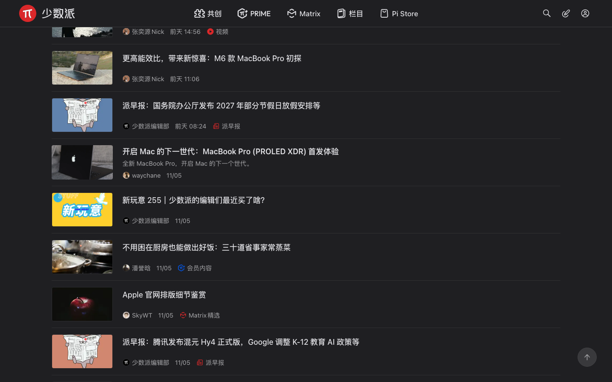

<div align="center">

# 📰 少数派 · 阅读增强

**一个 Tampermonkey 用户脚本，把 [sspai.com](https://sspai.com) 改成一个只用来读东西的地方。**

[](sspai-tidy.user.js)
[](https://sspai.com)
[](https://www.tampermonkey.net/)
[](LICENSE)

**[⬇️ 安装](https://raw.githubusercontent.com/hulatu/sspai-tidy/main/sspai-tidy.user.js)** ・
**[🎛 想改点什么](#-想微调)** ・
**[⚠️ 失效了怎么办](#-注意)**

</div>



## 📑 目录

| 想了解 | 看这里 |
| --- | --- |
| 它到底动了什么 | [🎯 一句话](#-一句话) ・ [📊 数字对比](#-数字对比) |
| 文章页有什么变化 | [📖 文章页：读完就结束](#-文章页读完就结束) |
| 原站功能怎么保留 | [🧩 原生功能优先](#-原生功能优先) |
| 怎么装 | [🚀 装法](#-装法) |
| 想自己调 | [🎛 想微调](#-想微调) |
| 坏了 / 不生效 | [⚠️ 注意](#-注意) |

## 🎯 一句话

少数派的列表页把三分之二的屏幕给了轮播、侧栏和推广卡，文章页在正文之后又堆了近 2000px 的广告、打赏、评论和「关联阅读」。

这个脚本把它们都拿掉，**一屏从 4 篇变成 9 篇，文章页读完正文就结束**；同时保留少数派自己的目录、图片查看器、分享和评论入口，只额外补上阅读进度条、代码块复制、已读标记和返回位置恢复。

## 📊 数字对比

在 1440×900 的窗口下实测（单条 = 一篇的高度）：

| | 首页 | Matrix | 作者主页 |
| --- | --- | --- | --- |
| 列表宽度 | 520 → **1064px** | 741 → **1064px** | 588 → **1064px** |
| 单条高度 | 189 → **99px** | 136 → **92px** | 178 → **121px** |
| 一屏（900px 高）能看到 | 4 → **9 篇** | 6 → **9 篇** | 5 → **7 篇** |



## 📖 文章页：读完就结束

一篇 11000px 的长文，原文总高 **13466px**，其中约 2400px（18%）不是正文。清完是 **11097px**。

| 清掉的块 | 高度 | 是什么 |
| --- | --- | --- |
| `.article__charge__card` | 222px | 「N 位派友已充电」打赏卡 |
| `.advertisement__box` | **398px** | 文末广告位 |
| `.post__comments` | 237px | 讨论区（底部固定栏的评论按钮还能打开弹窗，不算丢了入口） |
| `.related__read__wrapper` | 864px | 「关联阅读」 |
| `.comment__footer__wrapper` ×7 | 392px | 正文每个章节末尾的「发表首评 + 表情」互动条 |
| 文末推广句 ×2 | 约 64px | 「下载客户端 / 关注公众号」与「正版软件」推广 |

**保留**：正文、文章标签与责编信息、目录、底部固定的「说点什么… / 分享」栏。



## 🧩 原生功能优先

2.0 的核心原则是**只减少干扰，不接管原站交互**：

| 原站功能 | 脚本怎么处理 |
| --- | --- |
| 文章目录 | 完全保留站方组件和固定按钮，不覆盖展开状态，也不自动代点 |
| 图片查看器 | 不拦截图片点击；切换、缩略图、旋转、下载和 `Esc` 关闭都由原站处理 |
| 分享 / 评论入口 | 保留底部固定栏；只是默认收起占用大块纵向空间的评论区 |
| 登录、搜索、专题与标签 | 不修改 DOM，不屏蔽相关入口 |
| 深色主题 | 只复用原站 CSS 变量，不写死背景或正文颜色 |

原文中的付费声明、利益相关声明和产品信息不会被误删。脚本只隐藏明确指向广告、会员推广、客户端下载和商城的模块。

## ✨ 保留的四项增强

### 📊 阅读进度条

文章页顶部一条 2px 的红线，跟着滚动走。首页、Matrix、作者页不显示。
滚到底时宽度到 100%。滚动用 `requestAnimationFrame` 合并，图片加载和页面高度变化则由 `ResizeObserver` 触发，不再每 2 秒轮询。
进度条本身用 `transform: scaleX()` 而不是改宽度 —— 滚动时正是主线程最忙的时候，宽度动画每帧都要重新布局。

### 📋 代码块复制

正文里的 `<pre>` 右上角会出现一个「复制」按钮，悬停才显示（触摸设备上常显），点一下变「已复制」。
复制的是纯文本（不含按钮自己那两个字）。先走同步的 `execCommand`，不可用才退到 `navigator.clipboard` —— 反过来写的话，`await` 之后已经不在用户手势里，Safari 会直接拒绝，用户看到的是「复制失败」而剪贴板里还是旧内容。

### ✅ 已读标记

读过的文章，在首页 / Matrix / 作者页的列表里会**变灰**：标题降到次要灰，作者、时间、摘要和缩略图再压一档，鼠标悬停恢复。
不是整张卡压到 48% —— 那样标题的对比度只剩 2.7–3.2:1，低于 WCAG AA 的 4.5:1，扫读反而更费劲。
把 `CFG.hideRead` 改成 `true` 就换成另一种用法：已读文章直接从列表消失，配合「滚到底自动加载」就是一个只看新文章的信息流。
记录只写在你自己浏览器的 `localStorage`（`sspai-tidy:read`），最多存 400 条，按最近访问排序。支持站内相对链接和绝对链接，不上传任何地方。

### 🔖 返回列表时回到原位置

从列表点进文章、再退回来，会停在你刚才读到的那一行。位置按路由记在 `sessionStorage`，关掉标签页就忘；只在列表页（首页 / feed / Matrix / 搜索 / 作者页）生效，超过十分钟的旧位置不再跳转。

## 🚀 装法

1. 装 [Tampermonkey](https://www.tampermonkey.net/)（Chrome / Edge / Firefox 商店都有；Safari 用 [Userscripts](https://apps.apple.com/app/userscripts/id1463298887)）。
2. 点 **[sspai-tidy.user.js](https://raw.githubusercontent.com/hulatu/sspai-tidy/main/sspai-tidy.user.js)** —— 会弹出安装页，点「安装」。
3. 打开 <https://sspai.com/> ，生效。

> 脚本头里写了 `@updateURL` / `@downloadURL`，以后我推新版本，Tampermonkey 会自己提示更新，不用手动重装。

装不上就手动来：Tampermonkey 面板 → 添加新脚本 → 把 `.user.js` 全文粘进去替换模板 → `Cmd/Ctrl + S`。

## 🎛 想微调

脚本开头有一个 `CFG`，改完保存即生效：

```js
const CFG = {
  // ---- 列表页：减法 ----
  hideHero:      true,   // 顶部大 banner 区（派早报 / 投稿须知 / 广告位）
  hideLeftNav:   true,   // 首页左侧「推荐 / 全部内容 / 话题讨论 / 热门内容」
  hideRightSide: true,   // 首页「派友在看」、Matrix「值得关注 / 专栏推荐」
  hidePrime:     true,   // 列表里的 PRIME 会员社区精选
  hidePromo:     true,   // 列表里的「一派投票 / 讨论」推广卡
  hideCustomerService: true, // 右下角「联系客服」问号按钮（保留旁边的返回顶部）
  autoLoad:      true,   // 滚到底自动点「加载更多」（Matrix）
  thumb:         128,    // 列表缩略图宽度 px，0 = 不显示缩略图
  thumbSide:     'left', // 'left' 图在标题左边；'right' 保持站点原样
  compact:       true,   // false = 行高恢复宽松
  userDefaultPosts: true, // 进作者主页默认显示「文章」列表
  userWide:      true,   // 作者主页也拉宽、按首页样式重排

  // ---- 文章页：减法 ----
  hideArticleCharge:   true, // 「N 位派友已充电」打赏卡
  hideArticleAd:       true, // 文末广告位
  hideArticleComments: true, // 讨论区
  hideArticleRelated:  true, // 「关联阅读」
  hideInlineComment:   true, // 正文各章节末尾的「发表首评」互动条
  hideAppPromos:       true, // 文末的客户端 / 公众号 / 商城推广句

  // ---- 文章页：非侵入式增强 ----
  progressBar:   true,   // 顶部阅读进度条
  codeCopy:      true,   // 代码块右上角「复制」
  markRead:      true,   // 列表里标记读过的文章
  hideRead:      false,  // true = 已读文章直接从列表消失
  restoreScroll: true    // 从文章返回列表时回到上次的位置
};
```

几个常见的改法：

- **只想清广告，不想动排版**：`compact: false` + `userWide: false`
- **想更极端地只看标题**：`thumb: 0`，变成纯文字列表（单条 99 → 92px），没有图更安静
- **想留评论区**（少数派的评论质量通常不错）：`hideArticleComments: false`
- **不喜欢被标记**：`markRead: false`（已经记下的条目不会被清掉）；反过来想要「只看没读过的」，把 `hideRead` 改成 `true`。
- **只想要阅读进度条**：把上面所有 `hide*` 都改成 `false`，只留 `progressBar: true`
- **想保留站方推广句**：`hideAppPromos: false`

## 🚧 注意

- **少数派改版后类名可能会变**，脚本会失效（页面恢复原样，不会坏）。到时候把新类名替换进选择器即可 —— 改版最容易先坏的是 `.article__card` / `.post-item` / `.article__main__content` 这三个。
- 改宽度和行高的规则**只在窗口 ≥1000px 时生效**，窄窗口下用站点自己的布局，不会打架。
- 作者页的跳转只在**进入主页那一刻**发生：进去之后再手动点「动态 / 收藏」，不会被抢回来。
- 文章页那两个 `.article__subsection__wrapper` 只能清里面的内容块，**不能整个藏掉** —— 底部那条「说点什么…」固定栏的占位元素挂在里面，整块 `display:none` 会让那条栏塌成 0×0。脚本里已经按这个约束写了。
- 站点把整列包在 `.feed__wrapper` 里，并写死 `max-width: 960px`；只改 `.feed` 会被它卡住（实测只能到 960 / 卡片 904），所以两个都要放开。
- Matrix 的规则（`.container`、`.posts-list`、`.post-title`、`.post-cover`）全部通过当前 SPA 路由限定，只在 Matrix 页生效，避免误伤搜索页、标签页和文章页。
- 图片查看器和目录都完全交给原站。脚本不监听图片点击、不注册 `Esc`、不覆盖目录的展开样式。
- 常驻轮询已经移除：页面更新用共享 `MutationObserver` 合并到每帧一次，阅读进度用滚动、`ResizeObserver` 和图片 `load` 事件驱动。
- 脚本只改样式、触发「加载更多」、写一条本地已读记录；**不碰登录态、不读你的数据、不发任何网络请求**。

## 🧪 兼容性

在 Chrome（Helium 157）+ Tampermonkey 下开发，1440×900 窗口实测；首页 / Matrix / 作者主页 / 文章页四条路径都验证过，含浅色与深色主题。

用到的都是现代 CSS（`:has()`、`aspect-ratio`、CSS 变量），Chrome 105+ / Safari 15.4+ / Firefox 121+ 都没问题。2.0 已按当前站点的文章页重新核对目录、图片查看器、正文图片和广告选择器。

深色主题下同样生效，颜色全部走站点自己的 CSS 变量：



## 📄 许可

[MIT](LICENSE) —— 随便改、随便用，出问题别找我。
